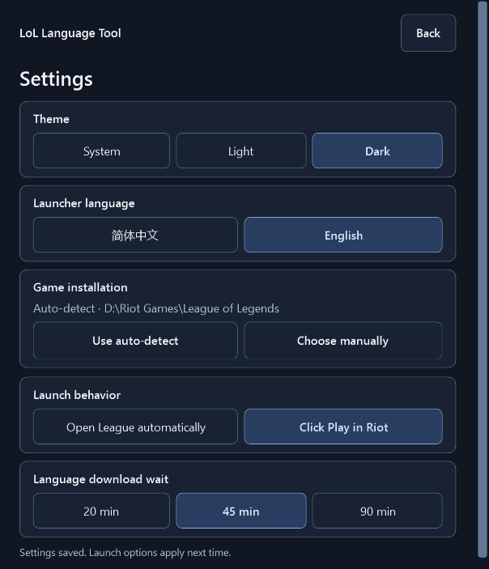

# LOL 大陆简中启动器

Windows 便携工具，通过 Riot 客户端为《英雄联盟》国际服切换大陆简体中文文字和英雄语音。切换流程已在台服（TW2）验证。

[下载 Windows 版](https://github.com/bfgd2jg/lol-chinese-launcher/releases/latest)

## 使用

1. 确认电脑已通过 Riot 客户端安装国际服，并退出英雄联盟大厅或对局。
2. 解压发行版 ZIP，双击 `LOL-Chinese-Launcher.exe`，点 **切换简中并启动**。
3. 首次由 Riot 下载语言资源。如果 Riot 显示 **更新** 或 **游玩**，按提示点击。启动器会显示资源进度，并核对客户端启动语言。

如果 Riot 仍用原语言启动，请退出英雄联盟大厅和托盘里的 Riot 客户端，再用工具重试。要切回去时，退出英雄联盟大厅后点 **恢复原语言**。工具会保存首次从其他语言切换时的原语言。

## 设置

- 界面可选跟随 Windows、浅色或深色。
- 启动器界面可选简体中文或 English。游戏语言的切换目标为大陆简体中文。
- 游戏路径默认自动识别。若识别失败，点 **手动选择**，选择 Riot 国际服安装目录里的 `LeagueClient.exe`。
- 默认自动请求打开英雄联盟，也可在 Riot 客户端手动点游玩。
- 语言资源的等待时间可选 20、45 或 90 分钟。

设置会保存在当前 Windows 用户目录。启动选项在下一次切换时生效。



## English quick start

Extract the Windows release and run `LOL-Chinese-Launcher.exe`. Open **Settings** and choose **English** to change the launcher interface. Choose **Launch in Chinese** to switch League’s text and champion voices to Simplified Chinese. Riot downloads the files on first use. Click **Update** or **Play** in Riot if prompted.

If automatic discovery fails, choose `LeagueClient.exe` in **Settings → Game installation → Choose manually**. Use the international League installation managed by Riot. Use **Restore language** to return to the game language saved on first switch.

## 编译与验证

适用 Windows 10 / 11，使用系统的 .NET Framework 编译器和 WPF。

```powershell
.\build.ps1
.\build.ps1 -Verify
```

可执行文件输出到 `artifacts/LOL-Chinese-Launcher.exe`。`-Verify` 在临时测试数据中验证安装发现、语言字段切换与恢复、设置持久化，并渲染界面到 `artifacts/qa`。

启动器从 Riot 的本地安装信息发现客户端，只在切换时修改 `settings.locale`，由 Riot 下载资源并启动游戏。启动器通过本机日志检查更新进度和实际启动语言。原语言和界面设置保存在 `%LOCALAPPDATA%\LeagueChineseLocaleLauncher`。

本项目采用 [MIT 许可证](LICENSE)。这是社区工具，发行包包含启动器、说明和许可证。
